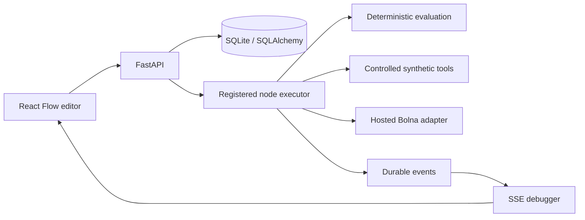

# Architecture

## Boundaries

One Next.js application and one FastAPI process share a local SQLite database through the backend only. React Flow is the visual editor; it never decides execution outcomes. The browser sends a graph version and run parameters. The executor loads the immutable version and evaluates a validated topological ordering.

## Source structure

- `apps/web/components/workspace.tsx`: workspace composition, run actions and dialog state.
- `workflow-node.tsx`: custom graph node renderer; `inspector.tsx`: schema-driven configuration and grounded evidence; `execution-console.tsx`: events, transcript, audio, errors.
- `apps/web/lib/editor.ts`: Zustand graph state, undo/redo, connections and Dagre layout.
- `services/api/sentinel/registry.py`: node contracts, validation, starter templates.
- `executor.py`: actual node handlers and execution state transitions.
- `governance.py`: authored scenarios, simulation, assertions, redaction and trusted tool authorization.
- `bolna.py`: isolated hosted transport and conservative artifact normalization.
- `store.py`: SQLAlchemy persistence; `main.py`: HTTP/SSE endpoints and lifecycle.

## Persistent schema / migration 1

`schema_version(version)` tracks the initial migration. Startup creates tables idempotently; no existing schema or historical evidence is dropped.

`documents(kind,id,body,created)` stores workflow heads, immutable version snapshots, runs, recordings, independent human review records, tool decisions, callback deduplication, connected agent summaries, and temporary private dispatch information. `events(run_id,seq,body)` provides ordered persistent events and reconnect cursor replay.

Version insertions use unique keys and optimistic concurrency. Mutable workflow heads reference immutable versions. Completed run records are read-only through public APIs; reviews are separate append-only records. Explicit user deletion/retention maintenance removes evidence rather than silently altering it. Future schema changes require numbered migrations; PostgreSQL deployment is not validated.

## Execution and data flow

Validation checks unique IDs, references, handle compatibility, config types/bounds, one trigger, DAG topology, mode compatibility and known implementations. Inputs come only from active predecessor outputs. Conditions choose `pass` or `fail`; inactive descendants are skipped. Merge joins active branches and deduplicates findings; conflicting non-finding keys use the last edge order (documented MVP behavior).

An emitted node event follows a persisted state transition. SSE replays durable events with IDs. Runs are fast in fixture mode: the frontend does not introduce fake delays. Inspectors read run snapshots, not regenerated fixtures. Normal UI edits do not mutate a saved run's graph.

Local pure handlers allow 1–3 attempts and a bounded timeout; connection errors/timeouts can retry. Bolna call creation cannot automatically retry. A dispatch intent is persisted before an external call. If the server dies during an uncertain dispatch, restart marks the run interrupted and requires operator inspection, preventing duplicate calls. Waiting provider IDs survive restart. Manual refresh or a signed gateway callback fetches authoritative provider state and resumes the graph. This is a single-process MVP, not a distributed durable worker system.

A local cancellation stops the task and marks active nodes blocked. Hosted calls cannot be cancelled safely through this UI; use Bolna's controls. Publication records local readiness, not internet deployment or trigger activation.

## Governance and evidence

Trusted subject identity is created by the synthetic harness or server configuration. Tool request `subject_id` and `verified` values do not grant authority. Every allowed/blocked synthetic tool result is stored with an idempotency fingerprint. No real account, payment or contact preference changes occur.

Policy evaluation is post-call detection. Tool decisions are preventive only at the controlled endpoint. Blocked attempts still produce an agent-behavior finding. Disabled or unsupported assertions remain explicit and prevent a passing test. Every deterministic finding quotes an actual segment; semantic results require exact segment ID/text equality. Reviews preserve the original finding.

PII redaction covers selected key names, email addresses and phone-like strings. It does not guarantee anonymization. Raw audio is not redacted, encrypted or diarized by this application. Transcripts and model outputs are never executable instructions. JSON uploads accept bounded, ordered segments; audio uses an optional transcription provider. No synthesized audio is presented as recorded evidence.

## Security/deployment scope

The MVP is a single trusted local workspace. No tenant-isolation or production identity claim is made. Origin checks, rate limiting, explicit test-number allowlisting, bounded provider calls, fixed outbound provider hosts, secret omission, upload limits and optional gateway tokens are included. An authenticated reverse proxy, project identity model, resource authorization, robust quotas, encryption, backups, trusted identity binding and durable workers are prerequisites to shared deployment.
